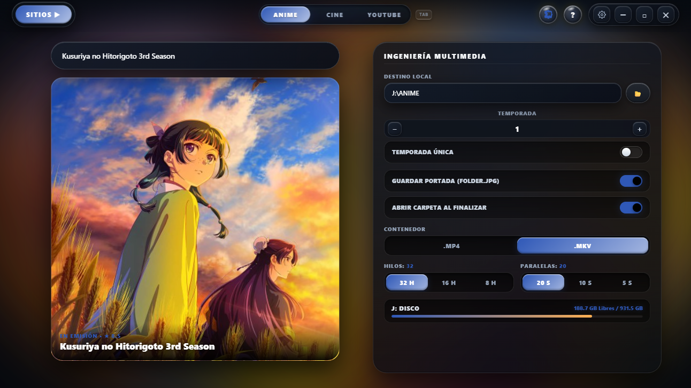
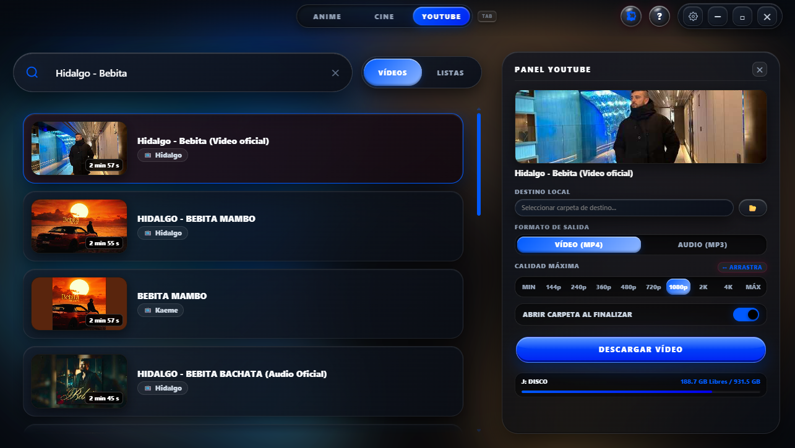
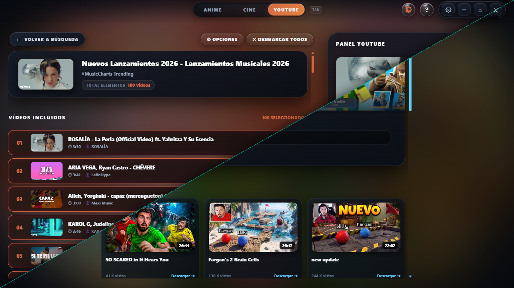
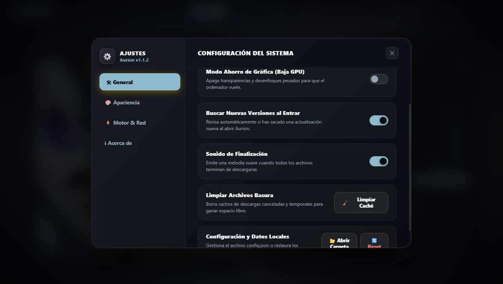

<div align="center">

  

  # AURION
  
  ### *Bájate tu anime, pelis y música sin anuncios, sin rollos y a toda mecha.*

  [](https://github.com/Manolilloo/Aurion/releases/latest)
  [](https://github.com/Manolilloo/Aurion)
  [](LICENSE.txt)
  [](https://python.org)

  <p align="center">
    <b>Aurion</b> es una aplicación de escritorio pensada para olvidarte de páginas llenas de publicidad, acortadores infernales y reproductores que no cargan. Todo en una interfaz oscura, limpia y fluida (hasta 165 Hz), con fondos que cambian según lo que estés viendo y un motor que exprime tu conexión al 100%.
  </p>

  [Descargar Instalador (.exe)](https://github.com/Manolilloo/Aurion/releases/latest) • [Poner la extensión](#-la-extensión-del-navegador) • [Qué hace la app](#-qué-puedes-hacer-con-aurion)

</div>

---

## 📸 Un vistazo rápido

<div align="center">

### 🍙 Nuevo Diseño Sección Anime/Cine


<br><br>

### 🔴 Sección YouTube con Nuevas Funciones


<br><br>

### 🌌 Nuevas Listas de YT y Vista de Canal


<br><br>

### ⚙️ Nuevos Ajustes Dentro de la App


</div>

<p align="right"><a href="#-aurion">▲ Volver arriba</a></p>

---

## ⚡ ¿Qué puedes hacer con Aurion?

### 🍙 Modo Anime
* **Temporadas enteras de un tirón:** Detecta los capítulos y te permite bajarte la temporada completa organizada en su carpeta con un solo clic.
* **Información y póster oficial:** Saca la carátula en máxima calidad (`folder.jpg`) y los metadatos directamente para que tu biblioteca quede de diez.
* **Control de lo que descargas:** Puedes elegir si quieres solo la temporada actual o todo del tirón, el formato de salida (.mkv o .mp4) y ver el peso antes de lanzarlo.

### 🎬 Modo Cine
* Busca películas al vuelo con sus portadas y datos organizados.
* Nada de reproductores lentos: descarga directa a tu disco duro para verla cuando y donde quieras.

### 🔴 Modo YouTube
* **Vídeos o Playlists completas:** Pega el enlace de un vídeo o de una lista entera y elige qué pistas quieres bajar.
* **Tú decides la calidad:** Desde 144p hasta 4K en vídeo, o solo el audio extraído en MP3 limpio a 320 kbps.
* **Explorador de canales:** Entra directamente al perfil del canal con su banner, foto y lista de vídeos recientes.
* **Sin bloqueos de interfaz:** Barra de arrastre intuitiva para la calidad, porcentaje en tiempo real y botón de cancelar reactivo por si te equivocas.

---

## 🎨 Una interfaz que entra por los ojos

* **Estilo Liquid Glass y bordes redondeados:** Olvídate de ventanas sosas de Windows. Aurion tiene su propio diseño frameless con desenfoques modernos y esquinas estilo squircle.
* **Carátula Giratoria Ambiental (Spinning Cover):** El fondo extrae los colores del póster y rota suavemente en bucle. Al maximizar la ventana se expande ocupando todo el monitor sin marcos negros.
* **Modo Ahorro de Gráfica:** Si estás jugando o no quieres que la GPU gaste recursos, puedes apagar los efectos pesados desde Ajustes en un segundo.
* **Actualizaciones automáticas:** La propia app te avisa con un puntito brillante cuando hay una versión nueva lista en GitHub.

---

## 🧩 La Extensión del Navegador

Para que no tengas que andar copiando enlaces a mano, Aurion incluye una extensión ultraligera para navegadores basados en Chromium (Brave, Chrome, Edge, Opera, etc.):

1. Abre Aurion y pulsa en el botón con forma de **pieza de puzle (🧩)** arriba a la derecha.
2. Abre tu navegador y ve a la sección de extensiones (`brave://extensions` o `chrome://extensions`).
3. Activa la casilla de **Modo Desarrollador**.
4. Pulsa en *«Abrir carpeta en Windows»* dentro del asistente de Aurion y **arrastra la carpeta `extension`** a la ventana del navegador.
5. ¡Listo! Cuando le des al play a un capítulo en tus páginas habituales, la extensión lo detecta y se lo manda a Aurion al instante.

---

## 🚀 Cómo instalarlo

### La forma fácil (Para usar la app)
1. Vete a la sección de [Releases de GitHub](https://github.com/Manolilloo/Aurion/releases/latest).
2. Bájate el archivo **`AurionSetup.exe`**.
3. Dale a siguiente, se instalará en tu equipo con su acceso directo e icono redondeado y a correr.

---

### Si eres dev y quieres tocar el código

Si quieres clonar el proyecto, trastear con él o ejecutarlo en local:

```bash
# 1. Clona el repo
git clone [https://github.com/Manolilloo/Aurion.git](https://github.com/Manolilloo/Aurion.git)
cd Aurion

# 2. Instala las librerías necesarias
pip install -r requirements.txt

# 3. Pon los binarios del motor
# Aurion necesita 'ffmpeg.exe' y 'aria2c.exe' para procesar los vídeos y descargar en paralelo.
# Descárgalos y colócalos dentro de la carpeta: bin/

# 4. Lanza la app
python main.py
